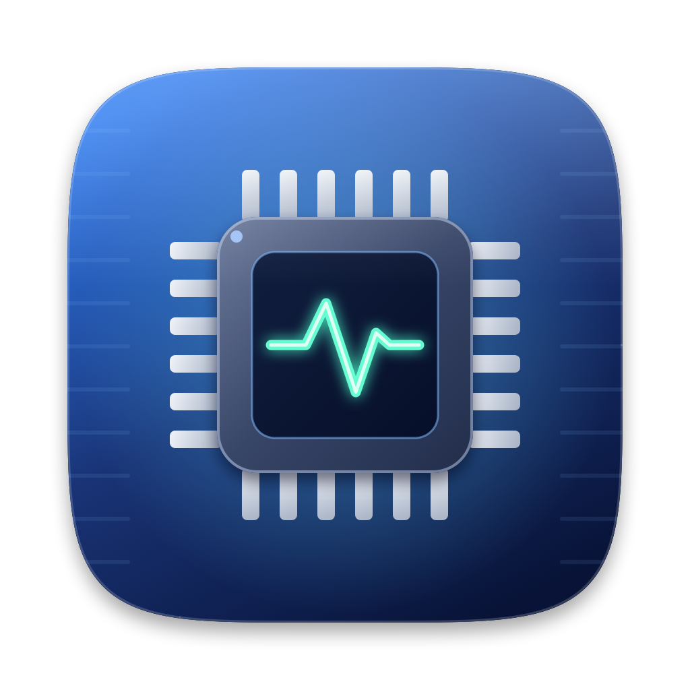

# System Monitor
<p align="center"></p>

A tiny native macOS menu bar app that shows live system stats as compact **icon + number** groups, right in the top bar.

```
[cpu] 6%   [ram] 83%   [drive] 79%   [thermo] 48°   [fan] 0rpm
```

Written in Swift with AppKit only — no dependencies, no Xcode project, no Dock icon. Built with a single script.

## Features

| Metric | What it shows | Turns red when | Shown by default |
|---|---|---|---|
| **CPU** | Total CPU usage across all cores, % | above 80% | yes |
| **Memory** | Memory used, % of installed RAM | above 80% | yes |
| **Storage** | Used space on the main disk, % | above 80% | yes |
| **CPU Temperature** | Hottest CPU core sensor, in °C | above 90°C | no |
| **Fan Speed** | Fastest fan's speed, in rpm | above 80% of that fan's max rpm | no |

- **Compact layout:** each group is an SF Symbol icon with the number beside it and a small unit (`%`, `°`, `rpm`). Each group is only as wide as its digits, so `6` takes one digit of space and `83` takes two. The whole item resizes as values change.
- **Light/dark mode:** icons and text follow the menu bar appearance.
- **Show/hide toggles:** pick which metrics appear from the menu. The choice is remembered across restarts. At least one metric is always shown: the last remaining one is ticked but greyed out so it can't be turned off. To switch, turn on the new one first, then turn off the old one.
- **Launch at Login:** registers itself as a login item the first time it runs, and can be switched on or off from the menu.
- **Tooltip:** hovering over the item shows every value, including hidden ones, e.g. `CPU 6%  Memory 83%  Storage 79%  Temp 48°C  Fan 0 rpm`.
- **Update rate:** every 2 seconds.
- **Activity Monitor shortcut:** the menu has an item that opens Activity Monitor.

## Menu

```
✓ Show CPU
✓ Show Memory
✓ Show Storage
✓ Show CPU Temperature
✓ Show Fan Speed
────────────────────
  Activity Monitor
✓ Launch at Login
────────────────────
  Quit
```

## Requirements

- macOS 13 or later (uses `SMAppService` for the login item)
- Xcode Command Line Tools (`xcode-select --install`) for `swiftc` and `codesign`
- Apple Silicon is what it was developed and tested on (M4 Pro); see [Temperature and fan notes](#temperature-and-fan-notes) for Intel caveats

## Build and run

```sh
./build.sh          # compiles and creates `System Monitor.app` next to the script
open "System Monitor.app"
```

`build.sh` compiles `main.swift` and `SMC.swift` with `swiftc -O`, copies in the app icon, writes an `Info.plist` (with `LSUIElement` set so there is no Dock icon), and ad-hoc signs the bundle with `codesign --sign -`.

To rebuild after a change:

```sh
pkill -x "System Monitor"; ./build.sh && open "System Monitor.app"
```

To stop it, use **Quit** in the menu or run `pkill -x "System Monitor"`.

## Starting at login

On first launch the app registers itself as a login item, and macOS may show a "Login Item Added" notification. You can turn it off or on from the **Launch at Login** menu item, or under System Settings → General → Login Items.

The login item points at the app's current location. If you move or rebuild the app somewhere else, switch **Launch at Login** off and on again. Moving it to `/Applications` is the more stable choice.

## How each value is measured

- **CPU:** `host_statistics(HOST_CPU_LOAD_INFO)` tick counters. Usage is the non-idle share of ticks since the previous refresh, so the first reading after launch is 0.
- **Memory:** `host_statistics64(HOST_VM_INFO64)`. Used = app memory (internal pages minus purgeable) + wired + compressed, as a share of installed RAM. This matches how Activity Monitor computes "Memory Used".
- **Storage:** `URLResourceValues` on `/`. Used = 1 − (available capacity for important usage ÷ total capacity), so purgeable space counts as free, like Finder.
- **Temperature and fan:** read from the System Management Controller (SMC) through IOKit. See below.

## Temperature and fan notes

`SMC.swift` is a small reader for the `AppleSMC` IOKit service. It needs no root privileges and no private frameworks.

- **Struct layout:** the request struct must match the kernel's 80-byte `SMCParamStruct` exactly, including padding after the version and key-info structs. A mismatch makes every call fail silently.
- **Temperature:** the app scans all SMC keys once and keeps the CPU core sensors: `Tp*` (performance cores) and `Te*` (efficiency cores). It shows the maximum. On the M4 Pro the `Tp*` sensors read a flat 40°C at idle and only move under load, so idle readings are about 40 to 50°C. Key names differ between chip generations, so on other chips the sensor list may differ.
- **Fans:** reads `FNum` (fan count), then `F<n>Ac` (actual rpm) and `F<n>Mx` (max rpm) for each fan. It shows the fastest fan. On Apple Silicon laptops the fans are usually stopped (0 rpm) until the machine is under sustained load. On a fanless Mac, such as a MacBook Air, the fan value shows `–`.
- **Unreadable sensors:** if a value can't be read, it shows `–` instead of a number.

## Project layout

```
main.swift   app entry point, menu, metric sampling, menu bar drawing
SMC.swift    SMC reader for temperature and fan speed
VERSION      current version, read by build.sh
build.sh     builds and signs System Monitor.app
make-dmg.sh  packages the app into a DMG (`./make-dmg.sh`, add `--rebuild` to rebuild first)
assets/      AppIcon.icns (used by the build) and AppIcon.png (1024px preview)
tools/       make_icon.swift: generates the app icon
README.md    this file
```

How the code is organised:

- `Monitor` reads CPU, memory and storage.
- `Sensors` wraps `SMC` for temperature and fan speed.
- `AppDelegate` owns the status item and the menu. A 2-second timer calls `update()`, which samples every metric (even hidden ones, so CPU deltas stay accurate), builds a list of `Reading` values for the shown ones, and draws them.
- `gauges(_:)` renders the readings into one `NSImage`, drawn with a drawing handler so it adapts to light and dark mode. Icons come from SF Symbols (`cpu`, `memorychip`, `internaldrive`, `thermometer.medium`, `fan`).

## App icon

The icon is a layered chip illustration drawn in code by `tools/make_icon.swift` (Core Graphics, no image editor needed). It follows Apple's macOS icon grid: a 1024 px canvas with an 824 px continuous-corner (squircle) body centred in it, leaving a transparent margin for the drop shadow.

Layers, back to front: body shadow, blue gradient background with a soft glow and faint circuit traces, chip pins, the chip package (with its own shadow for depth), the silicon die, a glowing activity-pulse glyph, and a glossy top highlight with a thin inner edge.

To regenerate it:

```sh
swiftc -O tools/make_icon.swift -o /tmp/make_icon
/tmp/make_icon assets/AppIcon.icns     # also writes assets/AppIcon.png
```

The `.icns` contains the standard 16 to 512 pt sizes at 1x and 2x. Edit the colours and shapes in `draw(_:)` to restyle it.

## Customising

- **Thresholds:** the red-colour rules are in `update()` in `main.swift` (the `hot:` argument of each `Reading`).
- **Sizes:** icon and number sizes are at the top of `gauges(_:)` (`iconW`, `gap`, `numFont`, `pctFont`, and the symbol `pointSize`).
- **Refresh interval:** the `withTimeInterval: 2` timer in `applicationDidFinishLaunching`.
- **Reset toggles:** `defaults delete com.tahir.sysmonitor` restores the default visible metrics and the first-run login-item registration.

## Troubleshooting

- **Nothing in the menu bar:** the item may be hidden behind the notch or by a crowded menu bar. Quit other menu bar apps, or hide some metrics with the toggles.
- **Temperature shows `–`:** the Mac's SMC didn't return any sensors in the expected key ranges (likely a different chip generation or Intel Mac).
- **Fan shows 0 rpm:** the fans are stopped, which is normal at idle on Apple Silicon.
- **Login item not starting after moving the app:** toggle **Launch at Login** off and on again from the new location.
- **"App can't be opened" warning:** the app is only ad-hoc signed. Run `./build.sh` on the machine you use it on, or right-click → Open once.

## Limitations

- Not notarised or signed with a developer ID, so it is meant to be built locally.
- Only the main disk (`/`) is monitored.
- Temperature shows a single hottest-core value, not a per-core breakdown.

## License

MIT. See [LICENSE](LICENSE).
